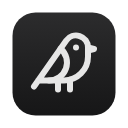
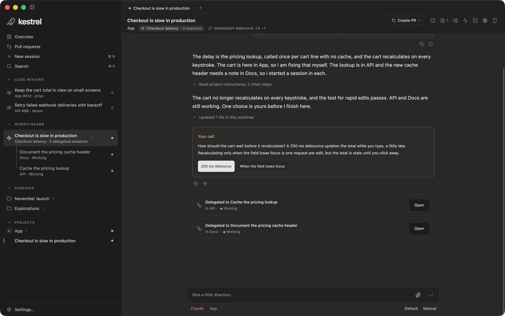

  

<h1 align="center">Kestrel</h1>

<strong>One workspace for your coding agents.</strong>

  Claude Code, Codex, and OpenCode. Your tasks, projects, and code reviews. One place to follow the work.

  <a href="https://starfish.nationalmachine.io/kestrel/releases/-/releases/permalink/latest/downloads/Kestrel.dmg"><strong>Download for Mac</strong></a>
  · <a href="https://kestrelapp.ai">Website</a>
  · <a href="https://kestrelapp.ai/docs/">Docs</a>
  · <a href="#get-started">Get started</a>
  · <a href="DEVELOPMENT.md">Build from source</a>

Apple Silicon · Signed &amp; notarized · Automatic updates · Open source

An example workspace: one checkout fix, three connected sessions, and one decision for you.

## Follow the task, across repositories

> “Checkout takes four seconds. Find out why and fix it. I don’t know which repo it’s in.”

Ask once. The app session investigates the frontend, delegates the pricing fix to a session in the API project, and asks a Docs session to update the reference. Each works with its own project’s instructions, tools, and environment.

A **workstream** keeps those conversations connected. Follow the whole task, see what is still running, and step in when an agent needs your judgment.

## A workspace for the whole job

- **Your agents, together.** Run Claude Code, Codex, and OpenCode using the sign-ins already on your Mac. Kestrel never asks for an API key.
- **Room to work in parallel.** Each session in a Git project gets its own worktree and branch, so several tasks can move forward in the same repository.
- **The next decision, in view.** See which sessions are working and which need you. Answer a question or give direction without losing the bigger picture.
- **Review where you work.** Inspect diffs, open a terminal or browser beside the conversation, and manage GitHub and GitLab pull requests—including reviews requested by other people.
- **A local workspace.** Kestrel runs on your Mac. Your chosen agents connect to their providers using their own accounts, and permission controls let you decide how much they can do without asking.

## Get started

1. **[Download Kestrel for Mac](https://starfish.nationalmachine.io/kestrel/releases/-/releases/permalink/latest/downloads/Kestrel.dmg)** and move it to Applications.
2. **Have an agent ready.** Claude needs no install: Kestrel includes Claude Code, and first-launch setup can sign you in (signing in to the Claude desktop app alone is not enough). Codex CLI and OpenCode are installed separately. First-launch setup checks what is available.
3. **Add a project and start a session.** Describe what you want to accomplish. Kestrel keeps the conversation and its working copy together.

For GitHub or GitLab pull requests, also sign in with `gh` or `glab`. Kestrel requires a Mac with Apple Silicon and checks for app updates automatically.

The **[Kestrel docs](https://kestrelapp.ai/docs/)** cover installing, projects, sessions, workstreams, permissions, and pull requests. There is more about the app at **[kestrelapp.ai](https://kestrelapp.ai)**.

## Build, contribute, or get help

Found a bug or have an idea? Open an issue in this repository. Include what you expected, what happened, your Kestrel and macOS versions, and the agent you were using.

Want to work on Kestrel? The **[development guide](DEVELOPMENT.md)** covers running from source, the demo workspace, configuration, tests, and the project layout. **[Release documentation](RELEASING.md)** explains packaging, signing, and updates.

Development happens on GitLab, and this GitHub mirror is updated after merges. Issues and pull requests are welcome here; accepted changes are applied upstream and arrive in the next sync.

## License

Kestrel is open source under the **[GNU AGPL v3](LICENSE)**.
